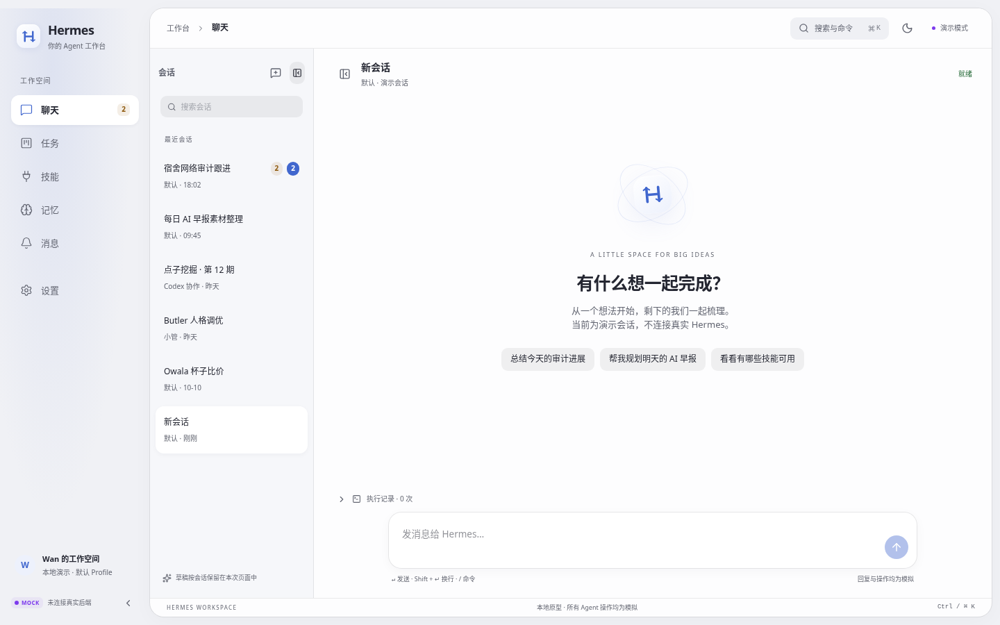
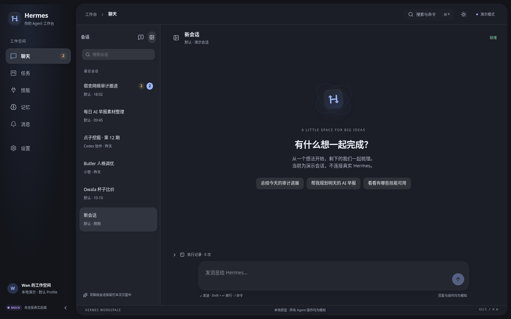
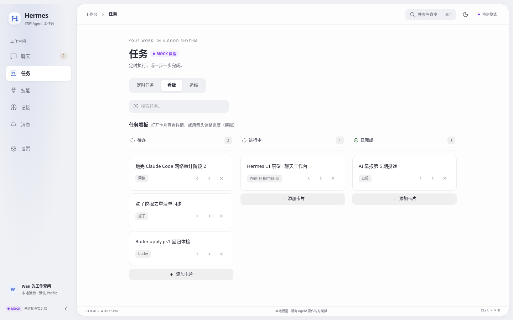
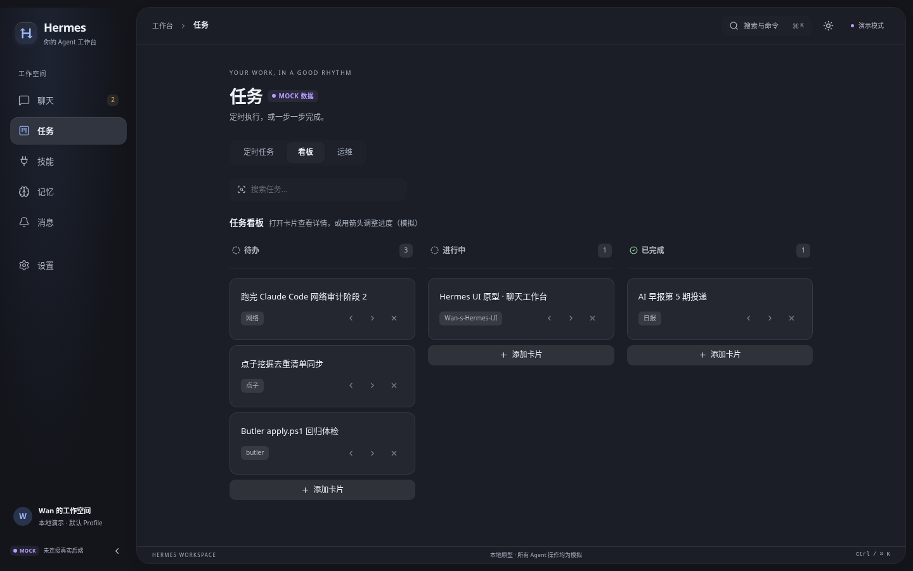

# Wan-s-Hermes-UI

给 Hermes 穿新衣 —— 为 [NousResearch Hermes Agent](https://github.com/NousResearch/hermes-agent)
桌面端设计并实现一套全新的交互体验。

## 当前阶段

**v0.5 UI / UX 精修**：独立分支 `feature/ui-craft-refinement`，基于已有 `feature/ui-prototype`，保留六工作台和数据适配层。

- [精修说明](docs/UI-REFINEMENT.md) · [变更记录](CHANGELOG.md) · [运行指南](RUN.md)
- [浏览器验证报告](docs/UI-QA-RESULTS.json) · [真实运行截图](docs/screenshots/README.md)
- 重点：安静的视觉层级、双主题、响应式抽屉、聊天连续性、任务详情与可撤销操作。
- 所有 Agent 操作仍为模拟；不连接本地 Hermes，不扩展核心后端。

### 实际界面

| 浅色 | 深色 |
|---|---|
|  |  |
|  |  |

## 原型速览

6 个工作台：**聊天**（会话/审批卡/工具时间线）· **任务**（定时任务+看板）· **技能** ·
**记忆**（条目+知识图谱）· **消息**（网关通道）· **设置**（Profile/模型/连接）

```bash
cd prototype && npm install && npm run dev
# 打开 http://127.0.0.1:5174
```

## 工程约束

- 不修改 `butler` 仓库（只读参考）与 Hermes 核心后端
- 不接触任何 API Key / Token / 私人数据
- 不直接向 main 提交、不合并 PR（Draft PR 待人工审查）
- 模拟功能全部明确标注，不冒充真实 Hermes 能力
